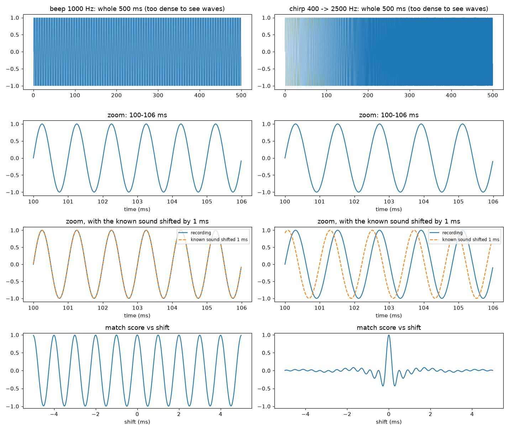

# 02 · SyncField · My note

What I understood from [concept.html](concept.html) and the labs, in my own words. Free form.

The order is sync_point -> armed -> 200ms wait (expect anchor) -> start chirp -> stop chirp.  
This is under the premise that worker starts data collecting task after start chirp sound.  

sync_point pairs monotonic clock and wall time. Only one exists in a session.  
Armed is the shared start line: data arriving after it gets recorded.  
Time between sync_point and armed is shared for all streams.  
There exists 200ms of wait time before start chirp sound.  
During this time, all streams are expected to have anchor time.  
Meaningful tactile data comes after start chirp.

Anchor time is when the first data arrived after the armed time. It exists per stream.  
Time between armed and anchor differs for each stream.

## fit_line in lab 3

### Why it is needed

Lab 3 plots one point per sample.  
x is `elapsed_s`: seconds since the first sample, on the host clock (capture_ns). It keeps growing.  
y is `device_minus_capture_us`: how far apart the two clocks are at that sample, in µs.

Without latency jitter, these points would lie on one straight line: offset at the start, growing by drift.  
In reality the arrival latency changes every sample, so the points scatter around that line.  
No single line passes through all of them, and every pair of points gives a different slope.  
Using only the first and last samples would put those two samples' jitter straight into the drift.  
fit_line uses all samples, so their jitter partly cancels out.  
The chirps are the two-point case: an error in finding either chirp goes straight into the drift (the ~280 ppm in lab 2).

The result is an estimate of the hidden line, not an exact value.  
More samples and a longer recording make it more accurate, but only for random jitter. A constant error stays.

### How the slope is computed

1. Take one center point: (mean_x, mean_y). There is only one for all samples.
2. Draw a line from the center to each point. Its slope is rise / run = `y deviation / x deviation`.
3. Take the weighted average of those slopes, with weight `x deviation²`.
4. `x deviation² × (y deviation / x deviation)` = `x deviation × y deviation`, so the weighted average becomes `xy_co_spread / x_spread`.

Why weight at all: a point close to the center in x gets a huge slope change from a tiny y wobble.  
Why squared, not just the x deviation:
- A point twice as far in x has half the slope error.
- Averaging n equally noisy measurements cuts the error to 1/√n, so half the error is worth 4 measurements.
- So the weight goes 1, 4, 9 for distance 1, 2, 3, which is x deviation².
- A simulation agreed: no weight gave slope spread 0.31, x deviation gave 0.13, x deviation² gave 0.11 (smallest).

Textbooks write slope = covariance / variance, which divides both sums by count.  
The count cancels, so the code divides the sums directly.

### What each result means

| Result | Meaning |
|---|---|
| slope (`drift_ppm`) | how fast the two clocks drift apart |
| intercept (`offset_at_first_sample_us`) | offset at the first sample − mean latency |
| residuals (`residuals_us`) | latency jitter, with offset and drift removed (assumes constant drift) |

Units are µs for y and s for x on purpose: 1 µs per 1 s = 1 ppm, so the slope is already in ppm.  
Lab 1's fake device uses `DEVICE_DRIFT_PPM = 40`, so the fitted drift should come out near 40.

`device - capture = offset - latency`.  
A constant latency only shifts the whole line down, so it hides inside the intercept. These two clocks alone can't separate offset from mean latency.  
Only the changing part of the latency is left in the residuals. A sample slower than average gives a negative residual.  
In lab 1, latency is 200–800 µs, so the residuals should spread about ±300 µs around 0.  
On a real device, coarse clock ticks or drift changing with temperature can also show up in the residuals.

### Jitter

jitter = each value − the expected value (here, the mean latency).  
The word usually means the size of that wobble overall, shown as a p1–p99 range or a standard deviation.  
It is not only about latency. 01-time lab 2's sleep jitter is the same idea: how far each interval misses its target.

## How a write reaches the disk

### The path and who moves data along it

| Step | Who calls it | Who does it | If nobody calls it |
|---|---|---|---|
| `file.write()`: into the Python buffer | program | Python | - |
| `file.flush()`: Python buffer → OS page cache | program | Python | Python flushes on its own when the buffer (~8 KB) fills or the file closes |
| `os.fsync(fd)`: page cache → disk | program | OS | the OS writes the page cache out on its own every few seconds, or when memory runs low |

fsync is also called by the program, not by the OS. The OS only carries it out.  
So the program can still step in after flush: calling fsync is that step.

In SyncField, each writer calls flush right after writing a row (StreamWriter, SessionLogWriter, SensorWriter without the queue).  
With the queue on (OGLO glove), a separate writer thread flushes per batch, at least every 0.1 s.  
None of them calls fsync. After flush, SyncField relies on the OS writing the page cache out on its own.

### fsync without flush

No error, and nothing bypasses the page cache.  
fsync writes what the OS has for that file. The OS can't see the Python buffer, so unflushed data is simply not written.  
Tested: write then fsync gave 0 bytes on disk; flush then fsync gave 6 bytes.  
It looks like success but protects nothing, so always flush, then fsync.

### What a crash loses

| Where the data is | Program crash | OS crash or power off |
|---|---|---|
| Python buffer, queue | lost | lost |
| OS page cache | survives | may be lost |
| disk cache | survives | may be lost |
| disk | survives | survives |

Program memory is the Python buffer plus the queue: anything not flushed yet.  
The page cache holds two kinds of data: dirty (not on disk yet) and clean (a copy of what's already on disk, kept for reads). Only dirty data is lost on power off, so "may be lost".  
The disk also has its own cache. It can answer "done" while data is only in that cache.  
On macOS, fsync() doesn't empty the disk cache; `fcntl(fd, F_FULLFSYNC)` does. Linux fsync() asks the disk to empty it too.  
So a finished fsync doesn't always mean the data is on the disk itself.

If power goes off during fsync, the program got no answer, so nothing is promised.  
Earlier lines may be on disk and later ones not, the last line may be cut off, and some file systems leave zero bytes at the end.  
JSON Lines still reads up to the last complete line.  
Journaling or copy-on-write (APFS) keeps the file system itself consistent, not the file's contents.

SyncField's trade-off: safe against a program crash, but a power cut can lose the last few seconds. In return, no row waits for the disk.

## Wave terms for the chirp

| Term | Meaning |
|---|---|
| wave (파동) | The air actually vibrating: the sound itself |
| waveform (파형) | The shape of that vibration drawn over time. The curve through a wav file's samples |
| cycle | One repetition of the wave. A 1000 Hz beep has a 1 ms cycle |
| crest | The top of one cycle. On the waveform it shows as the top of each bump |
| pitch | How high the sound is: how many cycles per second (Hz). Crest interval = 1 / pitch |
| peak | Not part of the wave: a high point of the cross-correlation score when the known sound is slid along the recording |

A chirp's pitch rises from 400 Hz to 2500 Hz, so its crest interval shrinks from 2.5 ms to 0.4 ms. "The pitch keeps changing" and "the crest interval keeps changing" say the same thing.

Crests that line up raise the score, and that spot is a peak:
- beep: shift it by 1 ms and the crests line up again, so the score has a peak every 1 ms.
- chirp: the crest interval keeps changing, so the crests line up only at one position, and the score has one peak.

Left: a 1000 Hz beep. Right: lab 2's 400 → 2500 Hz chirp, 500 ms each.
- Row 1: the whole 500 ms. Too many cycles to see the waveform.
- Row 2: zoomed to 100–106 ms. The beep's crests are 1 ms apart; the chirp's are about 1.2 ms apart here (about 820 Hz) and keep shrinking.
- Row 3: the known sound shifted by 1 ms (dashed). The beep lines up again; the chirp doesn't.
- Row 4: the score against the shift. The beep has a peak every 1 ms; the chirp has one peak at 0.
